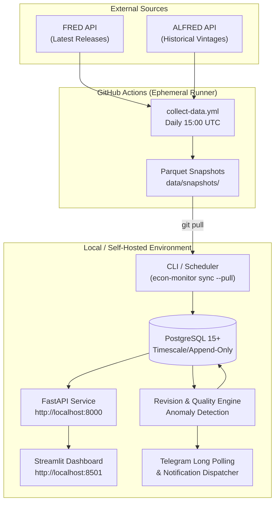

# System Architecture and Design Decisions

This document details the architectural choices, system boundaries, data lifecycles, and design trade-offs implemented in the **Economic Data Monitoring and Revision Tracking System**.

---

## 1. System Context and Architecture Overview

The system is organized into decoupled layers:
1. **Data Ingestion Engine:** Connects to Federal Reserve Economic Data (FRED) and ArchivaL FRED (ALFRED) to harvest real-time observations and point-in-time publication vintages.
2. **Snapshot Persistence (Parquet):** A zero-database storage layer designed to run within ephemeral GitHub Actions runners or local directories.
3. **Relational Core (PostgreSQL):** An append-only relational database storing series metadata, observations, vintages, revision deltas, anomalies, and subscriber state.
4. **Analytics & Revision Engine:** Pure mathematical functions computing revision metrics, vintage heatmaps, directionality, and data quality scores.
5. **Detection & Alerting Layer:** Statistical (Z-score) and machine learning (Isolation Forest) anomaly detectors paired with an idempotent Telegram notification dispatcher.
6. **Presentation Layer:** A FastAPI RESTful service consumed exclusively by a multi-page Streamlit and Plotly dashboard.

---

## 2. Ingestion & Persistence: Ephemeral Runners vs. Local Storage

### Problem
Ephemeral cloud runners (such as GitHub-hosted runners) do not have direct network access to private or local PostgreSQL databases. Running continuous database instances in cloud environments incurs cost and complex credential management.

### Architectural Decision
We established a strict separation between **harvesting** and **processing**:
- **GitHub Runner Role:** Only harvests raw observations and historical vintages from ALFRED and writes them into compressed, columnar Apache Parquet files (`data/snapshots/<SERIES_ID>/vintages.parquet`) along with a cryptographic SHA-256 manifest (`manifest.json`). No database connection or Telegram token is required.
- **Local Machine Role:** Pulls the repository (`git pull --ff-only`), reads the Parquet snapshots, verifies manifest integrity, and imports new rows into local PostgreSQL.
- **Unified Logic:** Both the snapshot collector and the direct database ingestor share identical normalization, validation, and batching code, differing solely in their `Sink` implementation (`SnapshotSink` vs `DatabaseSink`).

---

## 3. Immutability and Append-Only Data Modeling

### The Inherent Nature of Economic Revisions
Governments and statistical agencies (e.g., BEA, BLS, Federal Reserve) frequently revise macroeconomic statistics due to updated surveys, seasonal adjustment recalculations, and benchmark benchmark adjustments. In traditional data systems, updating rows in place destroys the history of what policymakers saw when decisions were made.

### Architectural Decision
- **Zero Modification or Deletion:** `observations` identify time points (`series_id`, `observation_date`). Every recorded value belongs to an `observation_vintages` row tagged with `vintage_date`. Vintage rows are strictly append-only.
- **Computed Revisions:** A revision is never a replacement of a vintage; it is a dedicated row in `revision_history` linking `from_vintage_id` to `to_vintage_id` with pre-computed deltas:
  $$\text{Absolute Revision} = V_{\text{to}} - V_{\text{from}}$$
  $$\text{Relative Revision \%} = \frac{V_{\text{to}} - V_{\text{from}}}{|V_{\text{from}}|} \times 100$$
- **Single Source of Current Truth:** A PostgreSQL view (`latest_observation_values`) computes the most recent vintage for every observation dynamically using window functions (`ROW_NUMBER() OVER (PARTITION BY observation_id ORDER BY vintage_date DESC)`), ensuring consistent reads across the system.

---

## 4. Anomaly Detection Architecture: Dual-Method Approach

Economic data exhibits both localized volatility and broad regime changes. Relying on a single detection algorithm leads to false positives during macroeconomic shocks (e.g., 2020 lockdowns).

### Architectural Decision
We employ a complementary two-tier detection pipeline:
1. **Statistical Rolling Z-Score:**
   - Detects short-term sudden deviations against a rolling window (default 24 months / 8 quarters).
   - Configurable sensitivity threshold (default $|Z| > 3.0$).
2. **Machine Learning Isolation Forest:**
   - Unsupervised outlier detection using multi-feature representations:
     - Transformed change ($pct\_change$ or $diff$)
     - Previous observation value
     - Trailing rolling mean
     - Trailing rolling standard deviation
     - Trailing rolling volatility
   - Identifies non-linear multidimensional outliers that pass univariate thresholds.

---

## 5. Strict Decoupling: Presentation vs. Domain Logic

### Architectural Decision
- **No Direct Database Imports in Streamlit:** To enforce system security and separation of concerns, code inside `dashboard/` is strictly forbidden from importing `sqlalchemy`, `econ_monitor.db`, or backend services directly.
- **API Boundary:** The dashboard communicates exclusively through HTTP calls via `ApiClient` (`dashboard/api_client.py`) to the FastAPI backend.
- **Automated AST Verification:** A dedicated test suite (`test_dashboard_boundaries.py`) parses the abstract syntax tree of all dashboard modules to programmatically enforce zero direct database access.

---

## 6. Notification Dispatcher & Idempotency Guarantees

### Architectural Decision
1. **Advisory Locking:** When running against PostgreSQL, the notification dispatcher requests a session-level advisory lock (`pg_try_advisory_lock(987654321)`) to guarantee that parallel tasks or schedules never send concurrent alerts.
2. **Natural Unique Keys:** Every alert event has a deterministic `event_key` (e.g., `revision_batch:CPI:2026-03-12` or `anomaly:GDP:2026-01-01:zscore`).
3. **Delivery History Constraints:** The `notification_history` table enforces a database-level unique constraint on `(subscriber_id, event_id, channel)`. An alert for a given event can only ever be created once per subscriber.
4. **Backfill Silence:** Initial historic data loads are tagged with `is_backfill = true` and silently stored without triggering notification delivery.
